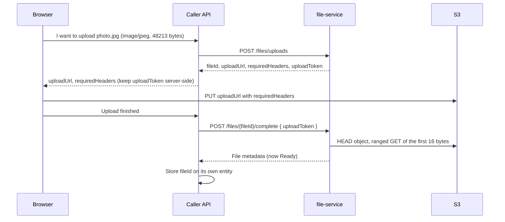

# file-service

A shared internal file service. It hands out presigned S3 URLs, so browsers upload and download bytes straight from S3, and it keeps file metadata in PostgreSQL. Several apps share one deployment; each app is a **client** with its own API key and key prefix, and can only see its own files.

HooviePack was the first client and ACBF is the second. The service was extracted from `hoovie-pack` (where it was `HooviePack.Files.Api`) with its history intact.

> [!IMPORTANT]
> **Never expose this service to the internet.** Its only callers are other services' backend APIs, which reach it on a private network. Browsers never call it directly: they only use the presigned S3 URLs it returns, which the caller's API passes to them.

- [The client flow](#the-client-flow)
- [API reference](#api-reference)
- [Configuration](#configuration)
- [S3 bucket setup](#s3-bucket-setup)
- [Running locally](#running-locally)
- [Images and releases](#images-and-releases)
- [Versioning](#versioning)
- [Development](#development)

## The client flow



1. **Create an upload.** The caller's API calls `POST /files/uploads` with the file's name, content type and size.
2. **The browser PUTs to S3.** It sends the bytes to `uploadUrl` with **every** header in `requiredHeaders`, and the exact byte count it declared. The URL is signed for that content type and length, so anything else fails at S3.
3. **The caller's API completes it.** It calls `POST /files/{fileId}/complete` with the `uploadToken`. Keep the token on the server; it proves the caller created this upload. The service checks the object's size, content type and leading bytes, then marks the file `Ready`.
4. **Store the `fileId`.** It is the only handle you need. To show a file, ask for a download URL when you need one (`GET /files/{id}/download`, or `POST /files/downloads` for a page of them). Download URLs are short-lived, so don't store them.

Uploads that are never completed are deleted after `FileStorage:PendingUploadTtlHours`; see [Abandoned uploads](#abandoned-uploads).

## API reference

All `/files/*` endpoints require the caller's API key in the `X-Internal-Api-Key` header. Bodies are JSON with camelCase property names. Errors are [RFC 9457 problem details](https://www.rfc-editor.org/rfc/rfc9457) (`application/problem+json`) with a `traceId`.

**Another client's file is always a 404**, identical to a file that does not exist, so callers can't learn which IDs exist. The same applies to `Pending` files wherever a `Ready` file is needed.

### Status codes common to every `/files/*` endpoint

| Status | When |
|---|---|
| `401 Unauthorized` | The `X-Internal-Api-Key` header is missing or doesn't match any client. Body: `{ "type": "about:blank", "title": "Unauthorized", "status": 401, "detail": "A valid internal service credential is required.", "traceId": "…" }` |
| `400 Bad Request` | The body is malformed or fails validation. |
| `503 Service Unavailable` | S3 couldn't be reached (`"title": "Storage unavailable"`). Safe to retry. |
| `500 Internal Server Error` | Anything else. Logged with the `traceId`. |

### `POST /files/uploads`: create an upload

Request:

```json
{ "fileName": "photo.jpg", "contentType": "image/jpeg", "size": 48213 }
```

| Field | Rules |
|---|---|
| `fileName` | 1–255 characters. Any directory part is dropped (`../a/photo.jpg` → `photo.jpg`); control characters are rejected. Used only for `Content-Disposition` on download. |
| `contentType` | One of the client's allowed content types, with no parameters (`image/jpeg`, not `image/jpeg; charset=…`). |
| `size` | Bytes, from 1 to the client's `MaxFileBytes`. |

`201 Created`, with `Location: /files/{fileId}`:

```json
{
  "fileId": "0199a1b2-…",
  "uploadUrl": "https://bucket.s3.us-east-2.amazonaws.com/files/0199a1b2…/original?X-Amz-…",
  "expiresAt": "2026-09-28T12:05:00+00:00",
  "requiredHeaders": { "Content-Type": "image/jpeg" },
  "uploadToken": "k3J…"
}
```

The object is stored at `{client KeyPrefix}/{fileId without dashes}/original`. The URL expires after `FileStorage:UploadUrlLifetimeMinutes`.

Errors: `400` for an invalid name, an unsupported or malformed content type, or a size of 0 or over the limit.

### `POST /files/{fileId}/complete`: finish an upload

Request:

```json
{ "uploadToken": "k3J…" }
```

`200 OK`:

```json
{ "fileId": "0199a1b2-…", "originalFileName": "photo.jpg", "contentType": "image/jpeg", "size": 48213, "createdAt": "2026-09-28T12:00:00+00:00" }
```

Completing a file that is already `Ready` returns the same body again, so retries are safe.

| Status | When |
|---|---|
| `404 Not Found` | No such file, another client's file, or the wrong `uploadToken`. |
| `409 Conflict` | The object isn't in S3 yet. Retry once the browser's PUT has finished. |
| `400 Bad Request` | The object's size or content type differs from what was declared, or its first bytes don't match the declared type (see below). **The object and the record are both deleted**, so start over with a new upload. |

**Content verification.** When `FileStorage:VerifyContentSignature` is on (the default), the service reads the object's first 16 bytes with a ranged GET and checks them against the declared type:

| Type | Must start with |
|---|---|
| `image/jpeg` | `FF D8 FF` |
| `image/png` | `89 50 4E 47 0D 0A 1A 0A` |
| `image/webp` | `RIFF`, any 4 bytes, then `WEBP` |

Types without a known signature pass this check.

### `GET /files/{fileId}/download`: one download URL

`200 OK`:

```json
{ "fileId": "0199a1b2-…", "downloadUrl": "https://…?X-Amz-…", "expiresAt": "2026-09-28T12:05:00+00:00" }
```

Before signing, the service HEADs the object and checks that its size and content type still match. The URL serves the object inline, with the stored content type and original file name. It expires after `FileStorage:DownloadUrlLifetimeMinutes`.

Errors: `404` if the file doesn't exist, isn't `Ready`, belongs to another client, or its S3 object is missing or changed.

### `POST /files/downloads`: download URLs in bulk

Request, with 1–100 **distinct** IDs:

```json
{ "fileIds": ["0199a1b2-…", "0199a1b3-…", "0199a1b4-…"] }
```

`200 OK`:

```json
{
  "items": [
    { "fileId": "0199a1b2-…", "downloadUrl": "https://…", "expiresAt": "2026-09-28T12:05:00+00:00" }
  ],
  "missing": ["0199a1b3-…", "0199a1b4-…"]
}
```

- Only the caller's `Ready` files get URLs. Every other ID goes in `missing`, with no distinction between "not yours", "doesn't exist" and "not finished uploading".
- Both lists keep the request's order.
- `400` for an empty or missing list, more than 100 IDs, or duplicates.

> [!NOTE]
> **Trade-off:** unlike the single download, the batch does **not** HEAD each object in S3, because 100 round trips would defeat the point. It trusts the `Ready` status. If an object was removed from S3 behind the service's back, its URL is still returned and S3 answers it with `403`/`404`. Use the single endpoint when you need that check.

### `DELETE /files/{fileId}`: delete a file

`204 No Content`. The S3 object is deleted first, then the record, so a failed call is safe to retry. `404` if the file doesn't exist or belongs to another client.

### Health

No API key is needed.

| Endpoint | Checks |
|---|---|
| `GET /health/live` | The process is up. |
| `GET /health/ready` (and `GET /health`) | PostgreSQL answers `SELECT 1`. If `FileStorage:CheckBucketOnReady` is on, it also HEADs the global bucket and every client bucket. |

Returns `200` with `{ "status": "healthy" }`, or `503` with `{ "status": "unhealthy" }`. In the `Development` environment the body also lists each check.

## Configuration

Configuration comes from `appsettings.json`, then `appsettings.{Environment}.json`, then environment variables (`Section__Key`, `Section__0__Key` for list items). **Secrets such as API keys and database passwords go in environment variables or a secret store, never in committed files.**

### Clients

```json
"Clients": [
  { "Id": "hooviepack", "ApiKey": "<secret>", "KeyPrefix": "files" },
  { "Id": "acbf", "ApiKey": "<secret>", "KeyPrefix": "acbf",
    "MaxFileBytes": 10485760, "AllowedContentTypes": ["image/jpeg", "image/png", "image/webp"], "BucketName": null }
]
```

As environment variables:

```sh
Clients__0__Id=hooviepack
Clients__0__ApiKey=...            # openssl rand -base64 48
Clients__0__KeyPrefix=files
Clients__1__Id=acbf
Clients__1__ApiKey=...
Clients__1__KeyPrefix=acbf
Clients__1__AllowedContentTypes__0=image/jpeg
Clients__1__AllowedContentTypes__1=image/png
```

| Field | Required | Rules |
|---|---|---|
| `Id` | Yes | Matches `^[a-z][a-z0-9-]{1,31}$`. Stored on every file record, so don't rename a client that has files. |
| `ApiKey` | Yes | 32 characters or more. Sent by the caller in `X-Internal-Api-Key`. |
| `KeyPrefix` | Yes | Matches `^[A-Za-z0-9][A-Za-z0-9/_-]{0,199}$`. Objects go under `{KeyPrefix}/`. |
| `MaxFileBytes` | No | Defaults to `FileStorage:MaxFileBytes`. |
| `AllowedContentTypes` | No | Defaults to `FileStorage:AllowedContentTypes`. |
| `BucketName` | No | Defaults to `FileStorage:BucketName`. |

The service refuses to start, listing every problem, if:

- any field breaks its rule;
- two clients share an `Id` or an `ApiKey`;
- two clients in the same bucket have prefixes where one equals the other or is a whole-segment prefix of it (`acbf` and `acbf/x` conflict; `acbf` and `acbfx` don't).

At startup it logs each client's ID, prefix and bucket. It never logs keys.

Each record stores the bucket it was written to, so changing a client's `BucketName` or `KeyPrefix` later only affects new uploads; existing files stay where they are.

### Legacy single-key mode (deprecated)

For compatibility with HooviePack's pre-extraction configuration: when `Clients` is empty and `InternalApi__ApiKey` is set, the service creates one client, `hooviepack`, with that key and `KeyPrefix = FileStorage:KeyPrefix`, and logs a warning at startup. Setting both `Clients` and `InternalApi__ApiKey` is a startup error.

To move off it, set `Clients__0__Id=hooviepack`, `Clients__0__ApiKey=<the same key>` and `Clients__0__KeyPrefix=files`, then remove `InternalApi__ApiKey`. Nothing else changes. **Legacy mode will be removed in 2.0.**

### `FileStorage`

| Key | Default | Meaning |
|---|---|---|
| `BucketName` | (required) | The global bucket. It's used by clients without their own `BucketName`, and by records created before clients existed. |
| `Region` | (required) | For example `us-east-2`. |
| `KeyPrefix` | `files` | Used only by legacy mode, as the `hooviepack` client's prefix. |
| `MaxFileBytes` | `10485760` | Default per-client upload limit. |
| `AllowedContentTypes` | JPEG, PNG, WebP | Default per-client allow-list. |
| `UploadUrlLifetimeMinutes` | `5` | 1–60. |
| `DownloadUrlLifetimeMinutes` | `5` | 1–60. |
| `VerifyContentSignature` | `true` | Check leading bytes on complete. |
| `CheckBucketOnReady` | `false` | Add S3 bucket HEADs to `/health/ready`. |
| `PendingCleanupEnabled` | `true` | Run the abandoned-upload cleanup. |
| `PendingCleanupIntervalMinutes` | `60` | How often it runs. It also runs once at startup. |
| `PendingUploadTtlHours` | `24` | Minimum 1. How old a `Pending` upload must be before cleanup deletes it. |
| `ServiceUrl` | (none) | For an S3-compatible endpoint such as MinIO. Leave unset for AWS. |
| `ForcePathStyle` | `false` | Usually `true` with `ServiceUrl`. |

### Other settings

| Key | Meaning |
|---|---|
| `ConnectionStrings__DefaultConnection` | PostgreSQL. Tables live in schema `files`, with the migrations history in `files."__EFMigrationsHistory"`. |
| `Database__ApplyMigrations` | Apply migrations at startup. The default is `true` in `Development` and `false` elsewhere; in production, run the migrations image instead. |

**AWS credentials** come from the SDK's default chain: `AWS_ACCESS_KEY_ID` / `AWS_SECRET_ACCESS_KEY` environment variables (the usual choice in compose), an `AWS_PROFILE`, or an instance or workload role. The identity needs `s3:PutObject`, `s3:GetObject` and `s3:DeleteObject` on every client's prefix, plus `s3:ListBucket` on each bucket if `CheckBucketOnReady` is on (S3 requires it for `HeadBucket`).

### Abandoned uploads

A background service deletes `Pending` records older than `PendingUploadTtlHours`, 100 at a time. For each one it deletes the S3 object first, then the row, the same order as `DELETE /files/{id}`. Failures are logged and retried on the next cycle; they never stop the service.

Records with a `LegacySourcePath` are skipped. HooviePack's legacy importer creates them with the original media's date, so an interrupted import would otherwise look abandoned straight away.

## S3 bucket setup

Browsers PUT and GET the presigned URLs directly, so the bucket needs a CORS rule allowing **each client's web origin**:

```json
[
  {
    "AllowedOrigins": ["https://hooviepack.example", "https://acbf.example", "http://localhost:4200"],
    "AllowedMethods": ["PUT", "GET"],
    "AllowedHeaders": ["Content-Type"],
    "ExposeHeaders": ["ETag"],
    "MaxAgeSeconds": 3000
  }
]
```

```sh
aws s3api put-bucket-cors --bucket <bucket> --cors-configuration file://cors.json
```

Keep the bucket private, with Block Public Access on. Presigned URLs work without any public access.

## Running locally

With Docker, a local PostgreSQL, and credentials for a dev bucket:

```sh
docker network create files-dev
docker run -d --name files-db --network files-dev \
  -e POSTGRES_USER=files -e POSTGRES_PASSWORD=files-dev-only -e POSTGRES_DB=files \
  postgres:17-alpine

DB='Host=files-db;Database=files;Username=files;Password=files-dev-only'

# Apply migrations. The migrations image is idempotent and exits non-zero on failure.
docker run --rm --network files-dev \
  -e "ConnectionStrings__DefaultConnection=$DB" \
  ghcr.io/jjeandervin/file-service-migrations:1.0.0

docker run -d --name files-api --network files-dev -p 5001:8080 \
  -e "ConnectionStrings__DefaultConnection=$DB" \
  -e FileStorage__BucketName=my-dev-bucket \
  -e FileStorage__Region=us-east-2 \
  -e Clients__0__Id=local -e Clients__0__KeyPrefix=local \
  -e Clients__0__ApiKey="$(openssl rand -base64 48)" \
  -e AWS_ACCESS_KEY_ID -e AWS_SECRET_ACCESS_KEY \
  ghcr.io/jjeandervin/file-service:1.0.0

curl http://localhost:5001/health/ready
```

**With MinIO instead of AWS**, add a MinIO container and point the service at it:

```sh
docker run -d --name minio --network files-dev -p 9000:9000 \
  -e MINIO_ROOT_USER=minio -e MINIO_ROOT_PASSWORD=minio-dev-only \
  quay.io/minio/minio server /data
# Create the bucket in the MinIO console or with `mc mb`, then run files-api with:
#   -e FileStorage__ServiceUrl=http://localhost:9000 -e FileStorage__ForcePathStyle=true
#   -e AWS_ACCESS_KEY_ID=minio -e AWS_SECRET_ACCESS_KEY=minio-dev-only
```

`ServiceUrl` is also the host the presigned URLs point at, so it must be reachable from the browser (`localhost:9000` here). Service-side calls then need to reach MinIO at that same address; the simplest way is to run `files-api` with `--network host`, or with `dotnet run`.

**From source:** `dotnet run --project src/FileService.Api` uses `appsettings.Development.json` and the `hooviepack-files-dev` AWS profile (see `Properties/launchSettings.json`), and applies migrations at startup. Configure a client in user secrets:

```sh
dotnet user-secrets --project src/FileService.Api set "Clients:0:Id" "hooviepack"
dotnet user-secrets --project src/FileService.Api set "Clients:0:KeyPrefix" "files"
dotnet user-secrets --project src/FileService.Api set "Clients:0:ApiKey" "$(openssl rand -base64 48)"
```

If your user secrets still hold `InternalApi:ApiKey` from before, remove it (`dotnet user-secrets --project src/FileService.Api remove "InternalApi:ApiKey"`) or leave `Clients` unset to run in legacy mode. Having both stops startup.

## Images and releases

Pushing a tag `vX.Y.Z` runs CI, then publishes two images to GHCR:

| Image | Contents |
|---|---|
| `ghcr.io/jjeandervin/file-service` | The API. Listens on `8080` and has a Docker `HEALTHCHECK` on `/health/ready`. |
| `ghcr.io/jjeandervin/file-service-migrations` | An EF Core migrations bundle. Run it once per deployment, before the API. |

Each image is tagged `X.Y.Z`, `X.Y` and the full commit SHA. A pre-release tag such as `v1.1.0-rc.1` gets only its own version and the SHA. **There is no `latest` tag; pin a version.** The images carry OCI labels for source, version and revision.

**Visibility.** The packages are public: the images contain no secrets, and the homelab and ACBF pull them without logging in. GHCR creates a new package as private, so after the first release open each package's **Package settings** and set **Change visibility** to **Public**.

To make them private instead, set the visibility to **Private**. Then, on every host that pulls, log in with a personal access token (classic) that has only the `read:packages` scope:

```sh
echo "$GHCR_READ_TOKEN" | docker login ghcr.io -u <github-user> --password-stdin
```

To release, merge to `main`, update [CHANGELOG.md](CHANGELOG.md), then:

```sh
git tag v1.0.0 && git push origin v1.0.0
```

## Versioning

Releases follow [Semantic Versioning](https://semver.org). Every release is listed in [CHANGELOG.md](CHANGELOG.md).

**Breaking changes need a major version.** These count as breaking:

- removing or renaming an endpoint, request field or response field, or changing its type;
- a new required request field, or a stricter rule that rejects requests that used to succeed;
- changing a status code for an existing case;
- removing or renaming a configuration key, or changing a default in a way that changes behavior (for example turning off `VerifyContentSignature`);
- a migration that the previous major version's image can't run against (the database must stay compatible with the previous image, so rollbacks work);
- removing legacy single-key mode (planned for 2.0).

Minor versions add endpoints, optional fields and configuration with safe defaults. Patch versions fix bugs.

## Development

```sh
dotnet test FileService.slnx
```

Tests that need PostgreSQL are skipped unless `FILESERVICE_TEST_POSTGRES` is set. Each test creates and drops its own database, so the user needs `CREATEDB`:

```sh
docker run -d --rm --name fs-test-pg -p 55432:5432 \
  -e POSTGRES_USER=fs_tests -e POSTGRES_PASSWORD=ci-only-not-a-secret -e POSTGRES_DB=fs_tests postgres:17-alpine
export FILESERVICE_TEST_POSTGRES='Host=127.0.0.1;Port=55432;Database=fs_tests;Username=fs_tests;Password=ci-only-not-a-secret'
```

To add a migration:

```sh
dotnet tool restore
dotnet ef migrations add <Name> --project src/FileService.Api --output-dir Infrastructure/Data/Migrations
```

Never edit or regenerate a migration that has shipped. Keep new columns nullable or give them a default, so the previous image keeps working against the migrated database.

CI (`.github/workflows/ci.yml`) runs on every push and pull request. It scans the history with gitleaks, audits NuGet dependencies, builds with warnings as errors, runs the tests against PostgreSQL 17, and builds both images. With those images it applies the migrations twice, checks that the API reaches `/health/ready` in legacy mode, and scans with Trivy.
